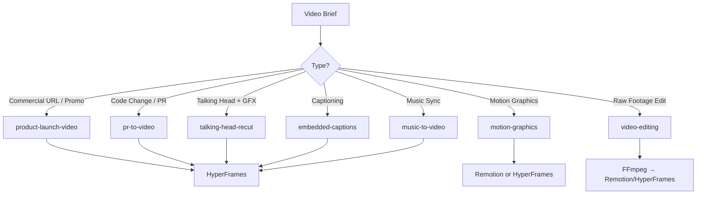

# Phase M — Video Creation & Editing

## Purpose
Create and edit video content using HyperFrames, Remotion, and related tools. This phase integrates with the 12-phase pipeline — use it when the brief requires video deliverables (promos, explainers, social clips, captioned content).

## When to Use
- Product launch videos
- Feature demos / changelog videos
- Social media promos (TikTok, Reels, Shorts)
- Explainer / educational videos
- Captioned talking-head content
- Music videos / beat-synced edits

## Hard Gate
> Video approved by `browser-qa` visual review + `review-animations` standards + platform specs met
> If **fail** → Return to Phase G (Animation) or Phase F (Implementation)

---

## Video Tool Selection Matrix

| Task | Primary Tool | Fallback |
|------|--------------|----------|
| **Scroll-driven / cinematic web video** | HyperFrames (`hyperframes`, `hyperframes-animation`, `hyperframes-cli`) | Remotion |
| **React-based programmatic video** | Remotion (`remotion`, `remotion-best-practices`, `remotion-video-creation`) | HyperFrames |
| **Product launch / promo from URL** | `product-launch-video` → HyperFrames | Remotion |
| **PR to video** | `pr-to-video` → HyperFrames | Remotion |
| **Talking-head + graphics** | `talking-head-recut` → HyperFrames | Remotion |
| **Captioned content** | `embedded-captions` → HyperFrames | Remotion |
| **Music-driven video** | `music-to-video` → HyperFrames | Remotion |
| **Motion graphics (short, <30s)** | `motion-graphics` → Remotion/HyperFrames | GSAP + HTML |
| **Video editing (raw footage)** | `video-editing` → FFmpeg/Remotion/HyperFrames | DaVinci/CapCut |

---

## Workflow

### Step 1: Choose Pipeline (from `video-production` router)



### Step 2: HyperFrames Pipeline (Primary)

**From `hyperframes`, `hyperframes-cli`, `hyperframes-core`, `hyperframes-animation`:**

1. **Brief** → `hyperframes` skill routes to correct workflow
2. **Compose** → Write `index.html` with `data-*` timing attributes, tracks, clips
3. **Assets** → `media-use` resolves BGM, SFX, images, voiceover
3. **Design** → `hyperframes-creative` for design spec, `hyperframes-keyframes` for camera moves
4. **Animate** → `hyperframes-animation` (GSAP default, or Lottie/Three.js/Anime.js/CSS)
5. **Preview** → `hyperframes-cli preview` / `play` / `present`
6. **Render** → `hyperframes-cli render` (local) or `cloud` / `cloudrun` / `lambda`

**Key Files to Pull from Templates:**
- `references/design-templates/design-templates/hyperframes/` — house style, patterns, palettes, scripts
- `references/design-templates/design-templates/video-shortform/` — short-form template
- `references/design-templates/design-templates/video-hyperframes/` — continuous animation template

### Step 3: Remotion Pipeline (React Alternative)

**From `remotion`, `remotion-best-practices`, `remotion-video-creation`:**

1. **Init** → `remotion-create` or `npx create-video`
2. **Compose** → React components with `<Sequence>`, `<Composition>`
3. **Animate** → `remotion-video-creation` patterns (spring, transitions, 3D)
4. **Audio** → `remotion-captions`, `remotion-multimedia`
5. **Render** → `remotion-render` (local) or `remotion-lambda` / `remotion-cloudrun`

**Key Files to Pull from Templates:**
- `references/design-templates/design-templates/remotion/` — (if available)

### Step 4: Asset Resolution (from `media-use`)

```bash
# Resolve BGM
media-use resolve --type bgm --mood "cinematic, tension" --duration 30

# Resolve voiceover
media-use resolve --type voice --text "Your script here" --voice "en-US-Neural2-A"

# Resolve images
media-use resolve --type image --prompt "cinematic hero shot" --style "hyperrealistic"
```

### Step 5: Captioning (from `embedded-captions`, `remotion-captions`)

- **HyperFrames**: `<hf-captions>` component with `.vtt` or inline timing
- **Remotion**: `<Caption>` component with `remotion-captions` transcribe + animate

### Step 6: Platform Export

| Platform | Spec | Tool |
|----------|------|------|
| **TikTok/Reels/Shorts** | 9:16, 1080×1920, <60s | `hyperframes-cli render --format mp4 --preset tiktok` |
| **YouTube** | 16:9, 1920×1080/4K | `hyperframes-cli render --format mp4 --preset youtube` |
| **LinkedIn** | 1:1 or 16:9, <10min | `hyperframes-cli render --format mp4 --preset linkedin` |
| **Twitter/X** | 16:9, 1280×720, <140s | `hyperframes-cli render --format mp4 --preset twitter` |
| **Web embed** | WebM/MP4, responsive | `hyperframes-cli render --format webm,mp4` |

---

## Hard Gates (Video)

| Gate | Check | Tool |
|------|-------|------|
| **Animation Quality** | `review-animations` returns Approve | `review-animations` |
| **Visual Regression** | Browser QA passes | `browser-qa` |
| **Caption Accuracy** | 99%+ word accuracy | Manual spot-check |
| **Audio Sync** | <50ms drift | `hyperframes-cli preview` |
| **File Specs** | Platform requirements met | `ffprobe` |
| **Performance** | <100MB for web, <50MB for social | File check |

---

## Template Pulling Guide

For video tasks, pull these from `references/design-templates/design-templates/`:

| Template | Use For |
|----------|---------|
| `hyperframes/` | Base HyperFrames project structure, house style, patterns |
| `video-shortform/` | TikTok/Reels/Shorts vertical format |
| `video-hyperframes/` | Continuous animation / ambient video |
| `video-production/` | (if exists) general video project scaffold |
| `web-prototype/` | If video embeds in website |
| `saas-landing/` | If video is hero on landing page |

---

## Credits & Attribution

Video skills integrated:
- `hyperframes`, `hyperframes-animation`, `hyperframes-audio`, `hyperframes-cli`, `hyperframes-core`, `hyperframes-creative`, `hyperframes-keyframes`, `hyperframes-registry`, `hyperframes-studio`
- `remotion`, `remotion-best-practices`, `remotion-captions`, `remotion-create`, `remotion-docs`, `remotion-interactivity`, `remotion-maps`, `remotion-markup`, `remotion-multimedia`, `remotion-render`, `remotion-saas`, `remotion-studio`, `remotion-upgrade`, `remotion-video-creation`, `remotion-to-hyperframes`
- `video-production`, `video-editing`, `product-launch-video`, `pr-to-video`, `talking-head-recut`, `embedded-captions`, `music-to-video`, `motion-graphics`, `faceless-explainer`, `general-video`
- `media-use`, `fal-ai-media`, `animate`, `review-animations`, `gsap-*`, `motion-*`

---

*This phase extends the 12-phase pipeline. For non-video projects, skip Phase M. For video projects, execute after Phase L or in parallel with Phase G/H.*